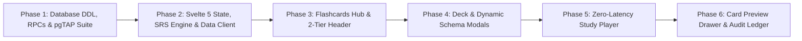

# Implementation Plan: Flashcards & Spaced Repetition Engine

> **Document Type**: Implementation Plan (IP) / Phased Delivery Roadmap  
> **Feature**: Flashcards & Spaced Repetition Engine  
> **Status**: Ready for Execution  

---

## 1. Overview & Strategy

This Implementation Plan decomposes the Flashcards & Spaced Repetition Engine into **6 small, verifiable, and manageable phases**, strictly following The Commons' engineering and design rules (anti-layer-cake vertical budget, Svelte 5 runes, zero blur effects, direct Supabase query layer, and multi-tenant RLS isolation).

---

## 2. Phased Implementation Roadmap

---

### Phase 1: Database Schema, Stored Procedures & Invariant Testing
**Goal**: Establish the PostgreSQL tables, RLS policies, PL/pgSQL stored procedures, and verify invariants with pgTAP and Vitest.

- [x] **1.1 Migration File**: Create timestamped migration in `supabase/migrations/`:
  - `public.decks`: UUID PK, `user_id` FK, self-referential `parent_id`, `name`, `description`, `config` JSONB.
  - `public.card_types`: UUID PK, `user_id` FK, `name`, `fields_schema` JSONB, `has_reverse` BOOLEAN.
  - `public.flashcard_notes`: UUID PK, `user_id` FK, `card_type_id` FK, `fields` JSONB, `tags` TEXT[].
  - `public.cards`: UUID PK, `user_id` FK, `note_id` FK, `deck_id` FK, `card_type` (0, 1), `queue_state` (-1..3), `ease_factor >= 1.30`.
  - `public.card_review_logs`: UUID PK, `user_id` FK, `card_id` FK, `rating` (1..4), audit interval and ease transitions.
- [x] **1.2 Stored Procedures (RPCs)**:
  - `create_flashcard_note_with_cards(p_deck_id, p_card_type_id, p_fields, p_tags)`: Transactional note ingestion and card provisioning.
  - `submit_card_review(p_card_id, p_rating, p_time_taken_ms)`: Atomic card state mutation + append-only audit log insert.
  - `get_study_queue(p_deck_id)`: Daily-quota filtered query (`new_cards_per_day` and `max_reviews_per_day`).
- [x] **1.3 RLS Security Policies**:
  - Direct user isolation: `auth.uid() = user_id` on all 5 tables.
- [x] **1.4 TypeScript Types & Vitest Suite**:
  - Update `src/lib/types/database.types.ts`.
  - Run `01_schema_constraints.test.sql`, `02_card_generation.test.sql`, `03_sm2_transitions.test.sql`, and `studyQueue.test.ts`.

**Phase 1 Verifiable Milestone**:
- Database migration applies cleanly with `supabase db reset` or `supabase test db`.
- 100% test pass rate across TS-01 through TS-05.

---

### Phase 2: Svelte 5 Runes State Store & Client Data Layer
**Goal**: Build the client state container, pure SM-2 algorithm engine, and typed Supabase RPC helper bindings.

- [x] **2.1 TypeScript Models**: Create `src/lib/types/flashcards.ts`:
  - `DeckRecord`, `CardTypeRecord`, `FlashcardNoteRecord`, `CardRecord`, `CardReviewLogRecord`, `StudyQueueItem`.
- [x] **2.2 Pure SM-2 Algorithm Engine**: Create `src/lib/features/flashcards/srs-engine.ts`:
  - `processReview(card, rating, learnSteps, leechThreshold)` with exact mathematical parity to PostgreSQL RPC.
- [x] **2.3 Client API Helpers**: Create `src/lib/services/flashcards-service.ts`:
  - `fetchDecks()`, `createDeck()`, `updateDeck()`, `deleteDeck()`.
  - `fetchCardTypes()`, `createCardType()`.
  - `createFlashcardNote(deckId, cardTypeId, fields, tags)`.
  - `fetchStudyQueue(deckId)`.
  - `submitReview(cardId, rating, timeTakenMs)`.
- [x] **2.4 Svelte 5 Reactive Store**: Create `src/lib/state/flashcards.svelte.ts`:
  - Centralized runes store managing `decks`, `cardTypes`, `activeDeck`, `studyQueue`, `activeCardIndex`.
  - Derived helpers: `dueTodayCount`, `newCardsCount`, `currentCard`, `hasMoreCards`.

**Phase 2 Verifiable Milestone**:
- Unit tests verify pure SM-2 math, state transitions, and store derivations without errors.

---

### Phase 3: Flashcards Hub & 2-Tier Header View
**Goal**: Implement the primary `/flashcards` index page conforming to the anti-layer-cake vertical budget.

- [x] **3.1 Page Route**: Create `src/routes/(app)/flashcards/+page.svelte` and `+page.server.ts`.
- [x] **3.2 2-Tier Header**:
  - Tier 1: Page title `Flashcards`, item count badge, and primary CTAs (`+ New Deck`, `+ Add Card`).
  - Tier 2: Horizontal unified toolbar with inline search and tab pills (`Decks`, `Card Types`, `Due Today`).
- [x] **3.3 Standardized List Views**:
  - Decks list view: hierarchical indentations, daily limits, due card counter, and direct `Study Now` CTA.
  - Card Types list view: schema overview and reverse configuration badges.
  - Due Today list view: itemized card list with queue state indicators.

**Phase 3 Verifiable Milestone**:
- Header strictly within 80–90px total height.
- At least 8–12 list items visible above the fold on desktop.

---

### Phase 4: Deck Creation Dialog & Dynamic Schema Modals
**Goal**: Deliver in-place modals for deck management and dynamic schema creation.

- [x] **4.1 Deck Modal**: Create `src/lib/components/flashcards/DeckModal.svelte`:
  - Inputs: name, description, parent deck selector, daily quotas (`new_cards_per_day`, `max_reviews_per_day`), and leech threshold.
- [x] **4.2 Schema Builder**: Create `src/routes/(app)/flashcards/card-types/new/+page.svelte`:
  - Dynamic field rows (key, display label) with drag/reorder capability.
  - Toggle for bidirectional card generation (`has_reverse`).
- [x] **4.3 Schema-Driven Note Creator**: Create `src/routes/(app)/flashcards/notes/new/+page.svelte`:
  - Dynamically renders textareas based on the selected card type's `fields_schema`.
  - Live preview indicator showing whether 1 or 2 cards will be created.

**Phase 4 Verifiable Milestone**:
- Users can create nested decks and custom card type schemas without page reloads.

---

### Phase 5: Zero-Latency Fullscreen Study Player
**Goal**: Build the distraction-free review player with keyboard shortcuts, flip animation, and background syncing.

- [x] **5.1 Study Route**: Create `src/routes/(app)/flashcards/[deckId]/study/+page.svelte`.
- [x] **5.2 Flashcard Display Component**: Create `src/lib/components/flashcards/CardViewer.svelte`:
  - Fixed minimum height container (`min-h-[380px]`) to eliminate layout shifts.
  - Clear typography with no blur filters.
- [x] **5.3 Predictive Rating Bar**: Create `src/lib/components/flashcards/ReviewRatingBar.svelte`:
  - 4 buttons: `Again [1]`, `Hard [2]`, `Normal [3]`, `Easy [4]` with calculated prospective intervals underneath.
- [x] **5.4 Keyboard Control & Optimistic Transition**:
  - `Space` / `Enter` reveals answer; `1`-`4` logs rating.
  - Next card slides into view with 0ms local latency; background dispatches `submit_card_review`.
  - Re-queues lapsed cards 3 positions back in local queue.

**Phase 5 Verifiable Milestone**:
- Complete study loop operable entirely via keyboard without visual lag or secondary re-fetching.

---

### Phase 6: Card Preview Drawer & Audit Ledger
**Goal**: Slide-over drawer for inspecting card SRS metrics and immutable review history.

- [x] **6.1 Drawer Component**: Create `src/lib/components/flashcards/CardPreviewDrawer.svelte`:
  - Displays `queue_state`, `step_index`, `interval_days`, `ease_factor`, `reps`, `lapses`.
  - Renders front and back field content.
- [x] **6.2 Historical Audit Ledger**:
  - Displays chronologically ordered rows from `public.card_review_logs`.
  - Shows timestamp, rating, interval jump, ease adjustment, and response latency.
- [x] **6.3 Quick Card Actions**:
  - One-click actions to suspend card (`queue_state = -1`) or reset to new (`queue_state = 0`).

**Phase 6 Verifiable Milestone**:
- Clicking any card opens the drawer and displays accurate audit history and state metrics.
