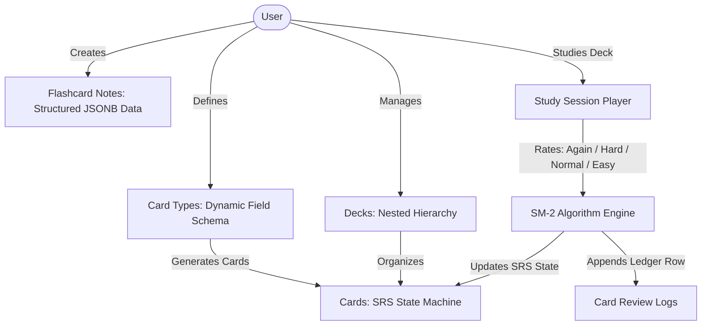

# Feature Spec: Flashcards & Spaced Repetition Engine

> [!NOTE]
> Living feature specification for the Spaced Repetition / Flashcard system in The Commons. Automatically rendered at `/dev/document`.

---

## 1. User Story & UX Flow

- **Problem Statement**: Users need an efficient, high-density flashcard and spaced repetition system inspired by Anki's battle-tested data model, but tailored to The Commons architecture: streamlined SM-2 scheduling, dynamic schema fields, seamless deck hierarchy, and zero latency during review sessions.
- **Target Persona**: Authenticated members.



### Primary Interaction Flows:
1. **Deck Management**:
   - Hierarchical container for organizing study material with parent/child deck support (`parent_id`).
   - Per-deck review settings (`decks.config`): daily new card limits, maximum reviews, learning steps in minutes, and leech threshold.
2. **Card Type (Schema) Definition**:
   - Define extensible schemas of fields (`fields_schema` e.g. `[{"name": "prompt", "label": "Question"}, {"name": "answer", "label": "Answer"}]`).
   - Configure bidirectional card generation (`has_reverse = true` generates both Forward and Reverse cards).
3. **Flashcard Note & Card Ingestion**:
   - Creating a flashcard note (`flashcard_notes`) validates fields against its card type schema and persists structured JSONB data.
   - Automatically generates reviewable `Card #0` (Forward: Prompt $\rightarrow$ Answer).
   - If `has_reverse = true`, simultaneously generates `Card #1` (Reverse: Answer $\rightarrow$ Prompt).
4. **Study & Review Session (`/flashcards/[deckId]/study`)**:
   - Select a deck to review. Card queue respects daily limits:
     1. Unseen / New (`queue_state = 0`): limited by `deck.config.new_cards_per_day`.
     2. Due (`queue_state IN (1, 2, 3)` AND `due_date <= CURRENT_DATE`): limited by `deck.config.max_reviews_per_day`.
   - Card face displays prompt fields; user flips (`Space` / `Enter`) to reveal answer fields.
   - User submits rating: **Again (1)**, **Hard (2)**, **Normal / Good (3)**, or **Easy (4)**.
   - SM-2 engine recalculates interval, ease factor, step index, and next due date, updating the card and appending a log atomically.

---

## 2. Core Entities & Architecture

```
┌─────────────────────────────────┐
│          public.decks           │
└────────────────┬────────────────┘
                 │ 1:N
                 ▼
┌─────────────────────────────────┐       ┌─────────────────────────────────┐
│          public.cards           │◄──────┤     public.flashcard_notes      │
│ (SRS state, queue, intervals)   │  1:N  │   (Raw structured field data)   │
└────────────────┬────────────────┘       └────────────────┬────────────────┘
                 │ 1:N                                     │ N:1
                 ▼                                         ▼
┌─────────────────────────────────┐       ┌─────────────────────────────────┐
│     public.card_review_logs     │       │        public.card_types        │
│  (Immutable historical ledger)  │       │     (Dynamic field schemas)     │
└─────────────────────────────────┘       └─────────────────────────────────┘
```

> [!IMPORTANT]
> **Schema Naming Disambiguation:**
> In The Commons, `public.notes` is already reserved for the Obsidian-style Markdown & Wiki-Link Knowledge Engine. To avoid table collision and semantic confusion, flashcard data records are named `public.flashcard_notes`, template schemas are named `public.card_types`, and the audit trail is named `public.card_review_logs`.

1. **Deck (`public.decks`)**: Hierarchical container for organizing flashcards.
2. **Card Type (`public.card_types`)**: Defines the schema of fields (e.g. `["Prompt", "Answer", "CodeSnippet"]`) and reverse generation policy.
3. **Flashcard Note (`public.flashcard_notes`)**: The data record holding structured key-value content and tags.
4. **Card (`public.cards`)**: The reviewable entity tracking scheduling metrics (`due_date`, `interval_days`, `ease_factor`, `queue_state`). Cards map directly to a flashcard note with a `card_type` indicator (0 = Forward, 1 = Reverse).
5. **Review Log (`public.card_review_logs`)**: An append-only ledger capturing every rating event, scheduling transition, and response latency.

---

## 3. Database Schema (PostgreSQL / Supabase DDL)

- **Primary Entities**: `public.decks`, `public.card_types`, `public.flashcard_notes`, `public.cards`, `public.card_review_logs`.
- **Identity Standard**: UUID primary keys (`gen_random_uuid()`).
- **User Ownership Standard**: `user_id UUID NOT NULL REFERENCES auth.users(id) ON DELETE CASCADE DEFAULT auth.uid()`.
- **Source of Truth**: Auto-generated in [`src/lib/types/database.types.ts`](file:///Users/daviditc/Documents/personal_projects/The-Commons/src/lib/types/database.types.ts).

```sql
CREATE EXTENSION IF NOT EXISTS "uuid-ossp";

-- ============================================================================
-- 1. DECKS
-- ============================================================================
CREATE TABLE public.decks (
    id UUID PRIMARY KEY DEFAULT gen_random_uuid(),
    user_id UUID NOT NULL REFERENCES auth.users(id) ON DELETE CASCADE DEFAULT auth.uid(),
    parent_id UUID REFERENCES public.decks(id) ON DELETE CASCADE,
    name VARCHAR(255) NOT NULL CHECK (char_length(name) > 0),
    description TEXT,
    config JSONB NOT NULL DEFAULT '{
        "new_cards_per_day": 20,
        "max_reviews_per_day": 200,
        "learn_steps_minutes": [1, 10],
        "leech_threshold": 8
    }'::jsonb,
    created_at TIMESTAMPTZ NOT NULL DEFAULT timezone('utc'::text, now()),
    updated_at TIMESTAMPTZ NOT NULL DEFAULT timezone('utc'::text, now())
);

CREATE INDEX idx_decks_user_id ON public.decks(user_id);
CREATE INDEX idx_decks_parent_id ON public.decks(parent_id);

-- ============================================================================
-- 2. CARD TYPES (Schema Definition)
-- ============================================================================
CREATE TABLE public.card_types (
    id UUID PRIMARY KEY DEFAULT gen_random_uuid(),
    user_id UUID NOT NULL REFERENCES auth.users(id) ON DELETE CASCADE DEFAULT auth.uid(),
    name VARCHAR(100) NOT NULL CHECK (char_length(name) > 0),
    -- Array of field descriptor objects: [{"name": "prompt", "label": "Question"}, {"name": "answer", "label": "Answer"}]
    fields_schema JSONB NOT NULL DEFAULT '[]'::jsonb,
    has_reverse BOOLEAN NOT NULL DEFAULT FALSE,
    created_at TIMESTAMPTZ NOT NULL DEFAULT timezone('utc'::text, now()),
    updated_at TIMESTAMPTZ NOT NULL DEFAULT timezone('utc'::text, now())
);

CREATE INDEX idx_card_types_user_id ON public.card_types(user_id);

-- ============================================================================
-- 3. FLASHCARD NOTES (Data Records)
-- ============================================================================
CREATE TABLE public.flashcard_notes (
    id UUID PRIMARY KEY DEFAULT gen_random_uuid(),
    user_id UUID NOT NULL REFERENCES auth.users(id) ON DELETE CASCADE DEFAULT auth.uid(),
    card_type_id UUID NOT NULL REFERENCES public.card_types(id) ON DELETE RESTRICT,
    fields JSONB NOT NULL DEFAULT '{}'::jsonb,
    tags TEXT[] NOT NULL DEFAULT '{}',
    checksum VARCHAR(64),
    created_at TIMESTAMPTZ NOT NULL DEFAULT timezone('utc'::text, now()),
    updated_at TIMESTAMPTZ NOT NULL DEFAULT timezone('utc'::text, now())
);

CREATE INDEX idx_flashcard_notes_user_id ON public.flashcard_notes(user_id);
CREATE INDEX idx_flashcard_notes_card_type ON public.flashcard_notes(card_type_id);
CREATE INDEX idx_flashcard_notes_tags ON public.flashcard_notes USING GIN (tags);
CREATE INDEX idx_flashcard_notes_fields ON public.flashcard_notes USING GIN (fields);

-- ============================================================================
-- 4. CARDS (SRS State Machine)
-- ============================================================================
CREATE TABLE public.cards (
    id UUID PRIMARY KEY DEFAULT gen_random_uuid(),
    user_id UUID NOT NULL REFERENCES auth.users(id) ON DELETE CASCADE DEFAULT auth.uid(),
    note_id UUID NOT NULL REFERENCES public.flashcard_notes(id) ON DELETE CASCADE,
    deck_id UUID NOT NULL REFERENCES public.decks(id) ON DELETE CASCADE,
    
    -- 0 = Forward (Prompt -> Answer), 1 = Reverse (Answer -> Prompt)
    card_type SMALLINT NOT NULL DEFAULT 0 CHECK (card_type IN (0, 1)),
    
    -- Queue state: 0 = New, 1 = Learning, 2 = Review, 3 = Relearning, -1 = Suspended
    queue_state SMALLINT NOT NULL DEFAULT 0 CHECK (queue_state IN (-1, 0, 1, 2, 3)),
    
    -- Scheduling parameters
    due_date DATE NOT NULL DEFAULT CURRENT_DATE,
    step_index INT NOT NULL DEFAULT 0,
    interval_days INT NOT NULL DEFAULT 0,
    ease_factor NUMERIC(4, 2) NOT NULL DEFAULT 2.50 CHECK (ease_factor >= 1.30),
    
    -- Performance audit counters
    reps INT NOT NULL DEFAULT 0,
    lapses INT NOT NULL DEFAULT 0,
    
    created_at TIMESTAMPTZ NOT NULL DEFAULT timezone('utc'::text, now()),
    updated_at TIMESTAMPTZ NOT NULL DEFAULT timezone('utc'::text, now()),
    
    CONSTRAINT uq_card_note_type UNIQUE (note_id, card_type)
);

CREATE INDEX idx_cards_user_id ON public.cards(user_id);
CREATE INDEX idx_cards_study_queue ON public.cards (deck_id, queue_state, due_date);
CREATE INDEX idx_cards_note_id ON public.cards(note_id);

-- ============================================================================
-- 5. CARD REVIEW LOGS (Append-only Ledger)
-- ============================================================================
CREATE TABLE public.card_review_logs (
    id UUID PRIMARY KEY DEFAULT gen_random_uuid(),
    user_id UUID NOT NULL REFERENCES auth.users(id) ON DELETE CASCADE DEFAULT auth.uid(),
    card_id UUID NOT NULL REFERENCES public.cards(id) ON DELETE CASCADE,
    
    -- 1 = Again, 2 = Hard, 3 = Normal (Good), 4 = Easy
    rating SMALLINT NOT NULL CHECK (rating BETWEEN 1 AND 4),
    
    previous_state SMALLINT NOT NULL,
    previous_interval_days INT NOT NULL,
    previous_ease_factor NUMERIC(4, 2) NOT NULL,
    
    new_interval_days INT NOT NULL,
    new_ease_factor NUMERIC(4, 2) NOT NULL,
    
    time_taken_ms INT,
    reviewed_at TIMESTAMPTZ NOT NULL DEFAULT timezone('utc'::text, now())
);

CREATE INDEX idx_card_review_logs_user_id ON public.card_review_logs(user_id);
CREATE INDEX idx_card_review_logs_card_id ON public.card_review_logs(card_id);
CREATE INDEX idx_card_review_logs_reviewed_at ON public.card_review_logs(reviewed_at);

-- Row Level Security
ALTER TABLE public.decks ENABLE ROW LEVEL SECURITY;
ALTER TABLE public.card_types ENABLE ROW LEVEL SECURITY;
ALTER TABLE public.flashcard_notes ENABLE ROW LEVEL SECURITY;
ALTER TABLE public.cards ENABLE ROW LEVEL SECURITY;
ALTER TABLE public.card_review_logs ENABLE ROW LEVEL SECURITY;

CREATE POLICY "Users can manage own decks" ON public.decks
    FOR ALL USING (auth.uid() = user_id) WITH CHECK (auth.uid() = user_id);

CREATE POLICY "Users can manage own card_types" ON public.card_types
    FOR ALL USING (auth.uid() = user_id) WITH CHECK (auth.uid() = user_id);

CREATE POLICY "Users can manage own flashcard_notes" ON public.flashcard_notes
    FOR ALL USING (auth.uid() = user_id) WITH CHECK (auth.uid() = user_id);

CREATE POLICY "Users can manage own cards" ON public.cards
    FOR ALL USING (auth.uid() = user_id) WITH CHECK (auth.uid() = user_id);

CREATE POLICY "Users can manage own card_review_logs" ON public.card_review_logs
    FOR ALL USING (auth.uid() = user_id) WITH CHECK (auth.uid() = user_id);
```

---

## 4. Spaced Repetition Algorithm Specification

The system employs a modified **SuperMemo-2 (SM-2)** algorithm utilizing four distinct rating inputs:

- **Rating 1: `Again`** (Complete lapse / recall failure)
- **Rating 2: `Hard`** (Successful recall with significant strain)
- **Rating 3: `Normal`** (Successful recall with expected effort)
- **Rating 4: `Easy`** (Instant, effortless recall)

### Global Algorithm Constants

- $\text{Initial Ease Factor } (EF_0) = 2.50$
- $\text{Minimum Ease Factor } (EF_{\min}) = 1.30$
- $\text{Learning Steps (Minutes)} = [1, 10]$
- $\text{Graduating Interval} = 1\text{ day}$
- $\text{Easy Graduating Interval} = 4\text{ days}$
- $\text{Hard Multiplier} = 1.20$
- $\text{Easy Bonus} = 1.30$

---

### State Transitions & Formula Mechanics

#### Phase A: Learning Queue (`queue_state = 0` or `1`)

When a card is new or in acquisition steps, intervals are controlled by `deck.config.learn_steps_minutes` ($S_0 = 1\text{ min}$, $S_1 = 10\text{ min}$):

- **On `Again` (1):** Reset `step_index = 0`. Card is due in 1 minute (`due_date = CURRENT_DATE`).
- **On `Hard` (2):** Repeat current step index. Due today (`due_date = CURRENT_DATE`).
- **On `Normal` (3):**
  - If `step_index < steps.length - 1`: Advance `step_index += 1`. Due today in 10 minutes (`due_date = CURRENT_DATE`).
  - If `step_index == steps.length - 1`: Graduate to Review Queue (`queue_state = 2`).
    $$\text{interval\_days} = 1, \quad \text{due\_date} = \text{CURRENT\_DATE} + 1$$
- **On `Easy` (4):** Immediate graduation (`queue_state = 2`), bypassing remaining learning steps.
  $$\text{interval\_days} = 4, \quad \text{due\_date} = \text{CURRENT\_DATE} + 4$$

---

#### Phase B: Review Queue (`queue_state = 2`)

For cards that have completed acquisition, calculations adjust both the **Ease Factor** ($EF$) and the **Next Interval** ($I$):

1. **Ease Factor Adjustment Formula:**

$$EF_{\text{new}} = \max\left(1.30, \; EF_{\text{old}} + \left(0.1 - (5 - \text{rating}) \times (0.08 + (5 - \text{rating}) \times 0.02)\right)\right)$$

- **Again (1):** $EF_{\text{new}} = \max(1.30, \; EF - 0.20)$
- **Hard (2):** $EF_{\text{new}} = \max(1.30, \; EF - 0.15)$
- **Normal (3):** $EF_{\text{new}} = EF$ *(no change)*
- **Easy (4):** $EF_{\text{new}} = EF + 0.15$

2. **Interval Calculation Formula ($I_{\text{new}}$):**
- **On `Again` (1):**
  - `queue_state` changes to `3` (Relearning).
  - `lapses` increments by `+1`.
  - `interval_days = 1`.
  - Check: If `lapses >= leech_threshold`, set `queue_state = -1` (Suspended).
- **On `Hard` (2):**
  $$I_{\text{new}} = \max(I_{\text{old}} + 1, \; \text{round}(I_{\text{old}} \times 1.20))$$
- **On `Normal` (3):**
  $$I_{\text{new}} = \text{round}(I_{\text{old}} \times EF)$$
- **On `Easy` (4):**
  $$I_{\text{new}} = \text{round}(I_{\text{old}} \times EF \times 1.30)$$

3. **Due Date Assignment:**
$$\text{due\_date} = \text{CURRENT\_DATE} + I_{\text{new}}$$

---

## 5. Algorithm Engine Implementation Reference

The algorithm engine is encapsulated in a pure TypeScript module ([`src/lib/features/flashcards/srs-engine.ts`](file:///Users/daviditc/Documents/personal_projects/The-Commons/src/lib/features/flashcards/srs-engine.ts)):

```typescript
export type Rating = 'again' | 'hard' | 'normal' | 'easy';

export interface CardRecord {
  id: string;
  queue_state: number; // 0=New, 1=Learning, 2=Review, 3=Relearning, -1=Suspended
  step_index: number;
  interval_days: number;
  ease_factor: number;
  reps: number;
  lapses: number;
  due_date: string;
}

export interface ReviewResult {
  updatedCard: CardRecord;
  log: {
    rating: number;
    previous_state: number;
    previous_interval_days: number;
    previous_ease_factor: number;
    new_interval_days: number;
    new_ease_factor: number;
  };
}

const RATING_MAP: Record<Rating, number> = {
  again: 1,
  hard: 2,
  normal: 3,
  easy: 4,
};

export function processReview(
  card: CardRecord,
  rating: Rating,
  learnStepsMinutes: number[] = [1, 10],
  leechThreshold: number = 8
): ReviewResult {
  const ratingCode = RATING_MAP[rating];
  const prev = {
    state: card.queue_state,
    interval: card.interval_days,
    ease: card.ease_factor,
  };

  const next = { ...card };
  next.reps += 1;

  const today = new Date();
  const addDays = (days: number): string => {
    const d = new Date(today);
    d.setDate(d.getDate() + days);
    return d.toISOString().split('T')[0];
  };

  // INTRADAY / LEARNING PROCESSING (queue_state: 0, 1, 3)
  if (next.queue_state !== 2) {
    switch (rating) {
      case 'again':
        next.step_index = 0;
        next.queue_state = 1;
        next.interval_days = 0;
        next.due_date = addDays(0);
        break;

      case 'hard':
        next.queue_state = 1;
        next.due_date = addDays(0);
        break;

      case 'normal':
        if (next.step_index < learnStepsMinutes.length - 1) {
          next.step_index += 1;
          next.queue_state = 1;
          next.due_date = addDays(0);
        } else {
          next.queue_state = 2;
          next.step_index = 0;
          next.interval_days = 1;
          next.due_date = addDays(1);
        }
        break;

      case 'easy':
        next.queue_state = 2;
        next.step_index = 0;
        next.interval_days = 4;
        next.due_date = addDays(4);
        break;
    }
  } 
  // GRADUATED REVIEW PROCESSING (queue_state: 2)
  else {
    switch (rating) {
      case 'again':
        next.lapses += 1;
        next.ease_factor = Math.max(1.30, Number((next.ease_factor - 0.20).toFixed(2)));
        next.interval_days = 1;
        next.due_date = addDays(1);

        if (next.lapses >= leechThreshold) {
          next.queue_state = -1; // Auto-suspend leech
        } else {
          next.queue_state = 3;  // Drop to Relearning
          next.step_index = 0;
        }
        break;

      case 'hard':
        next.ease_factor = Math.max(1.30, Number((next.ease_factor - 0.15).toFixed(2)));
        next.interval_days = Math.max(next.interval_days + 1, Math.round(next.interval_days * 1.20));
        next.due_date = addDays(next.interval_days);
        break;

      case 'normal':
        next.interval_days = Math.max(next.interval_days + 1, Math.round(next.interval_days * next.ease_factor));
        next.due_date = addDays(next.interval_days);
        break;

      case 'easy':
        next.ease_factor = Number((next.ease_factor + 0.15).toFixed(2));
        next.interval_days = Math.max(
          next.interval_days + 1,
          Math.round(next.interval_days * next.ease_factor * 1.30)
        );
        next.due_date = addDays(next.interval_days);
        break;
    }
  }

  return {
    updatedCard: next,
    log: {
      rating: ratingCode,
      previous_state: prev.state,
      previous_interval_days: prev.interval,
      previous_ease_factor: prev.ease,
      new_interval_days: next.interval_days,
      new_ease_factor: next.ease_factor,
    },
  };
}
```

---

## 6. Routes & Component Matrix

| Route / Component Path | Type | Responsibility |
| :--- | :--- | :--- |
| `src/routes/(app)/flashcards/+page.svelte` | Page View | Deck ledger, study queue counters, deck quick-add dialog |
| `src/routes/(app)/flashcards/+page.server.ts` | Loader & Actions | Fetch decks with due/new card tallies; deck CRUD actions |
| `src/routes/(app)/flashcards/[deckId]/study/+page.svelte` | Page View | Zero-latency study canvas: flip animation, rating buttons (`1`-`4`) |
| `src/routes/(app)/flashcards/[deckId]/study/+page.server.ts` | Loader & Actions | Fetch review queue applying deck limits; submit review action |
| `src/routes/(app)/flashcards/note-types/+page.svelte` | Page View | Card type schema designer & field builder |
| `src/lib/components/flashcards/CardViewer.svelte` | Component | Render front/back field content with dynamic schema mapping |
| `src/lib/components/flashcards/ReviewRatingBar.svelte` | Component | 4-button rating bar with next interval estimate tooltips |
| `src/lib/features/flashcards/srs-engine.ts` | Core Utility | Pure SM-2 scheduling state machine & transition logic |

---

## 7. Acceptance Criteria & Invariants

- [ ] **Disambiguated Schema Names**: Uses `public.flashcard_notes`, `public.card_types`, and `public.card_review_logs` without colliding with the Obsidian Notes engine (`public.notes`).
- [ ] **Automated Card Generation**: Ingesting a flashcard note creates `Card #0` (Forward), and if `card_types.has_reverse = true`, generates `Card #1` (Reverse) in the same transaction.
- [ ] **Daily Limit Enforcements**: Deck review queues strictly adhere to `decks.config.new_cards_per_day` for unseen cards (`queue_state = 0`) and `decks.config.max_reviews_per_day` for due cards (`due_date <= CURRENT_DATE`).
- [ ] **Atomic Review Transitions**: Submitting a card rating updates the card SRS state and inserts a `card_review_logs` row in an atomic operation.
- [ ] **Leech Detection & Auto-Suspension**: When a card accumulates `lapses >= leech_threshold` (default: 8), its `queue_state` automatically shifts to `-1` (Suspended).
- [ ] **Full User Isolation (RLS)**: Authenticated users can only read and mutate decks, card types, flashcard notes, cards, and review logs that belong to them (`user_id = auth.uid()`).
