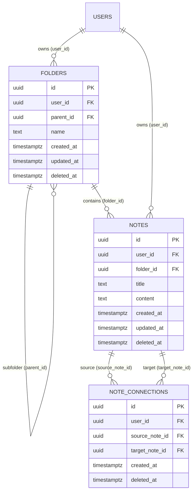

# Feature Spec: Notes & Wiki-Link Knowledge Engine

> [!NOTE]
> Living feature specification for the Obsidian-style Note System in The Commons. Automatically rendered at `/dev/document`.

---

## 1. User Story & UX Flow

- **Problem Statement**: Users need a bidirectional wiki-linked note-taking engine with a hierarchical folder tree, relational graph visualization, and safe lifecycle management (soft-delete with orphan or recursive cascade strategies and a Recycle Bin).
- **Target Persona**: All authenticated users.

```mermaid
graph TD
    User([User]) -->|Creates / Navigates| F1[Folder Tree / Explorer]
    F1 -->|Contains| N1[Note: Architecture Overview]
    N1 -->|Wiki-link [[Database Schema]]| N2[Note: Database Schema]
    N1 -->|Wiki-link [[API Spec]]| N3[Note: API Spec]
    N1 -.->|Sync Trigger| NC[note_connections Graph]
    User -->|Soft-Deletes Folder / Note| RB[Recycle Bin]
    RB -->|Restore or Permanent Purge| Storage[(Postgres Storage)]
```

### Primary Interaction Flows:
1. **Folder Hierarchy & Organization**:
   - Nested folder tree via self-referential `parent_id`.
   - Notes assigned to folders via `folder_id` or residing at root level (`folder_id = null`).
2. **Bidirectional Wiki-Linking & Graph Engine**:
   - Notes support inline `[[Wiki Link]]` syntax in markdown content.
   - Postgres triggers automatically parse tokens into bidirectional edges in `note_connections`.
   - Forward links and backlinks are queried in real time (`deleted_at is null`).
3. **Soft-Delete Lifecycle & Deletion Strategies**:
   - Deleting a note marks `deleted_at = now()`, deactivating connections from active views while preserving textual `[[Title]]` tokens.
   - Deleting a folder offers two strategies via `delete_folder(folder_id, cascade_children)`:
     - **Option A (Cascade / Delete with Children)**: Recursively soft-deletes the target folder and all descendant folders and notes.
     - **Option B (Orphan / Delete Parent Only)**: Soft-deletes only the target folder; immediate child folders and notes are promoted to root level (`parent_id = null`, `folder_id = null`).
4. **Recycle Bin & Restoration**:
   - Dedicated Recycle Bin modal/panel to view trashed folders and notes.
   - `restore_note()` and `restore_folder()` reactivate items and reconnect graph edges.
   - `purge_item()` permanently hard-deletes records.

---

## 2. Database Schema & Data Integrity

### 2.1 Entity Relationship Model

- **Primary Entities**: `public.folders`, `public.notes`, `public.note_connections`.
- **Identity Standard**: UUID primary keys (`gen_random_uuid()`).



### 2.2 Table Definitions & Indexes (Draft Migration)

```sql
create extension if not exists "uuid-ossp";
create extension if not exists "pg_trgm";

-- 1. FOLDERS TABLE
create table public.folders (
  id uuid default gen_random_uuid() primary key,
  user_id uuid references auth.users(id) on delete cascade default auth.uid() not null,
  parent_id uuid references public.folders(id) on delete set null,
  name text not null check (char_length(name) > 0 and name !~ '[/\\:]'),
  created_at timestamptz default timezone('utc'::text, now()) not null,
  updated_at timestamptz default timezone('utc'::text, now()) not null,
  deleted_at timestamptz default null
);

-- 2. NOTES TABLE
create table public.notes (
  id uuid default gen_random_uuid() primary key,
  user_id uuid references auth.users(id) on delete cascade default auth.uid() not null,
  folder_id uuid references public.folders(id) on delete set null,
  title text not null check (char_length(title) > 0),
  content text default '' not null,
  created_at timestamptz default timezone('utc'::text, now()) not null,
  updated_at timestamptz default timezone('utc'::text, now()) not null,
  deleted_at timestamptz default null
);

-- Unique title per active note (allowing deleted notes to release the title)
create unique index uq_active_user_note_title 
  on public.notes (user_id, lower(title)) 
  where deleted_at is null;

-- 3. EXPLICIT CONNECTIONS / GRAPH TABLE
create table public.note_connections (
  id uuid default gen_random_uuid() primary key,
  user_id uuid references auth.users(id) on delete cascade default auth.uid() not null,
  source_note_id uuid references public.notes(id) on delete cascade not null,
  target_note_id uuid references public.notes(id) on delete cascade not null,
  created_at timestamptz default timezone('utc'::text, now()) not null,
  deleted_at timestamptz default null,

  constraint uq_note_connection unique (source_note_id, target_note_id),
  constraint ck_no_self_link check (source_note_id <> target_note_id)
);

-- Performance Indexes
create index idx_folders_active on public.folders (user_id, parent_id) where deleted_at is null;
create index idx_notes_active on public.notes (user_id, folder_id) where deleted_at is null;
create index idx_conn_active_src on public.note_connections (source_note_id) where deleted_at is null;
create index idx_conn_active_tgt on public.note_connections (target_note_id) where deleted_at is null;
create index idx_notes_title_trgm on public.notes using gin (lower(title) gin_trgm_ops);
```

### 2.3 Graph Synchronization Engine

Trigger function parses `[[Wiki Link]]` tokens on note insert/update, syncs edges, and deactivates edges when notes are soft-deleted:

```sql
create or replace function public.handle_note_connections()
returns trigger as $$
declare
  target_rec record;
begin
  -- If note was soft-deleted, soft-delete all its outgoing and incoming connections
  if NEW.deleted_at is not null and OLD.deleted_at is null then
    update public.note_connections
    set deleted_at = NEW.deleted_at
    where (source_note_id = NEW.id or target_note_id = NEW.id)
      and deleted_at is null;
    return NEW;
  end if;

  -- If note was restored, reactivate connections where target is also not deleted
  if NEW.deleted_at is null and OLD.deleted_at is not null then
    update public.note_connections nc
    set deleted_at = null
    where nc.source_note_id = NEW.id
      and exists (
        select 1 from public.notes target_n
        where target_n.id = nc.target_note_id
          and target_n.deleted_at is null
      );
    return NEW;
  end if;

  -- Normal content edit on active note: purge and re-extract
  delete from public.note_connections where source_note_id = NEW.id;

  if NEW.deleted_at is null then
    for target_rec in
      with extracted_tokens as (
        select distinct lower(trim(m[1])) as token_title
        from regexp_matches(NEW.content, '\[\[(.*?)\]\]', 'g') as m
        where trim(m[1]) <> ''
      )
      select n.id as matched_id
      from extracted_tokens t
      inner join public.notes n 
        on lower(n.title) = t.token_title
       and n.user_id = NEW.user_id
      where n.id <> NEW.id 
        and n.deleted_at is null
    loop
      insert into public.note_connections (user_id, source_note_id, target_note_id)
      values (NEW.user_id, NEW.id, target_rec.matched_id)
      on conflict (source_note_id, target_note_id) 
      do update set deleted_at = null;
    end loop;
  end if;

  return NEW;
end;
$$ language plpgsql security definer;

create trigger tr_sync_note_connections
after insert or update of content, deleted_at on public.notes
for each row execute function public.handle_note_connections();
```

### 2.4 Stored Procedures (RPCs)

```sql
-- 1. Folder Deletion RPC with Two Strategies
create or replace function public.delete_folder(
  target_folder_id uuid,
  cascade_children boolean
)
returns void as $$
declare
  current_user_id uuid := auth.uid();
  now_ts timestamptz := timezone('utc'::text, now());
begin
  if cascade_children then
    -- OPTION 1: Recursive cascade soft-delete
    with recursive folder_tree as (
      select id from public.folders 
      where id = target_folder_id and user_id = current_user_id
      union all
      select f.id from public.folders f
      inner join folder_tree ft on f.parent_id = ft.id
      where f.user_id = current_user_id
    )
    update public.notes
    set deleted_at = now_ts
    where folder_id in (select id from folder_tree)
      and deleted_at is null;

    with recursive folder_tree as (
      select id from public.folders 
      where id = target_folder_id and user_id = current_user_id
      union all
      select f.id from public.folders f
      inner join folder_tree ft on f.parent_id = ft.id
      where f.user_id = current_user_id
    )
    update public.folders
    set deleted_at = now_ts
    where id in (select id from folder_tree)
      and deleted_at is null;

  else
    -- OPTION 2: Orphan immediate children (move to root level)
    update public.folders
    set parent_id = null
    where parent_id = target_folder_id 
      and user_id = current_user_id;

    update public.notes
    set folder_id = null
    where folder_id = target_folder_id 
      and user_id = current_user_id;

    update public.folders
    set deleted_at = now_ts
    where id = target_folder_id 
      and user_id = current_user_id;
  end if;
end;
$$ language plpgsql security definer;

-- 2. Restore Note
create or replace function public.restore_note(target_note_id uuid)
returns void as $$
begin
  update public.notes
  set deleted_at = null
  where id = target_note_id and user_id = auth.uid();
end;
$$ language plpgsql security definer;

-- 3. Restore Folder
create or replace function public.restore_folder(target_folder_id uuid)
returns void as $$
declare
  target_parent_id uuid;
begin
  select parent_id into target_parent_id 
  from public.folders 
  where id = target_folder_id and user_id = auth.uid();

  if target_parent_id is not null and exists (
    select 1 from public.folders where id = target_parent_id and deleted_at is not null
  ) then
    target_parent_id := null;
  end if;

  update public.folders
  set deleted_at = null, parent_id = target_parent_id
  where id = target_folder_id and user_id = auth.uid();
end;
$$ language plpgsql security definer;

-- 4. Purge Item Permanently
create or replace function public.purge_item(item_type text, item_id uuid)
returns void as $$
begin
  if item_type = 'note' then
    delete from public.notes 
    where id = item_id and user_id = auth.uid() and deleted_at is not null;
  elsif item_type = 'folder' then
    delete from public.folders 
    where id = item_id and user_id = auth.uid() and deleted_at is not null;
  end if;
end;
$$ language plpgsql security definer;
```

### 2.5 Row Level Security (RLS) Rules

- Active views only retrieve rows `where deleted_at is null`.
- Recycle bin views query `where deleted_at is not null`.
- Row Level Security policies enforce user-level boundary:

```sql
alter table public.folders enable row level security;
alter table public.notes enable row level security;
alter table public.note_connections enable row level security;

create policy "Users manage own folders" on public.folders
  for all using (auth.uid() = user_id) with check (auth.uid() = user_id);

create policy "Users manage own notes" on public.notes
  for all using (auth.uid() = user_id) with check (auth.uid() = user_id);

create policy "Users manage own connections" on public.note_connections
  for all using (auth.uid() = user_id) with check (auth.uid() = user_id);
```

---

---

## 3. UI/UX Architecture & Layout Structure

### 3.1 Primary Workspace Shell Layout

A 4-tier horizontal flex workspace coordinated inside `src/routes/(app)/notes/`:

```text
+---+----------------------+---------------------------------------------------+----------------------+
|   | VAULT EXPLORER       | MULTI-PANE WORKSPACE                              | CONTEXT DOCK         |
| R |                      |                                                   |                      |
| I | Header & New File    | +-----------------------+-----------------------+ | Header & Tab Switch  |
| B | -------------------- | | PANE 1 (Active)       | PANE 2 (Split Right)  | | -------------------- |
| B | File & Folder Tree   | | [Tab 1] [Tab 2] [+]   | [Tab 1] [+]           | | Backlinks List     |
| O | with Guide Lines     | | --------------------- | --------------------- | | Outgoing Links     |
| N |                      | | Live Preview Note     | Side-by-side Note /   | | Local Graph View   |
|   |                      | | or Embedded Graph     | Canvas Graph View     | | (Scoped to Active) |
+---+----------------------+-------------------------+-----------------------+----------------------+
| STATUS BAR: Word Count | Current Note Path | Sync Status | Active Panes: 2 | Graph Engine: Idle     |
+----------------------------------------------------------------------------------------------------+
```

- **Activity Ribbon (`ActivityRibbon.svelte`)**: Fixed 44px left vertical strip with icon triggers to toggle File Explorer, Global Graph view, Recycle Bin drawer, and Command Palette.
- **Vault Explorer Sidebar (`FileTree.svelte`)**: 260px collapsible panel displaying folders, subfolders with indentation guide lines, root notes, and creation buttons.
- **Workspace Split Grid (`WorkspaceGrid.svelte`)**: Dynamic multi-pane container subdividing the middle canvas into 1 to $N$ independent split panes side by side.
- **Pane Container (`PaneContainer.svelte`)**: Contains a top tab bar (`TabBar.svelte`) and an active view viewport (swappable between `LivePreviewEditor.svelte` and `GraphView.svelte`).
- **Context Dock Sidebar (`ContextDock.svelte`)**: 280px collapsible inspector showing backlinks, outgoing links, and a synced local graph for the currently focused note.
- **Status Bar (`StatusBar.svelte`)**: 24px bottom strip displaying document metrics, local graph depth, and Supabase synchronization states.

---

## 4. State Management Architecture (`src/lib/state/notes.svelte.ts`)

Centralized in-memory reactive state using **Svelte 5 Runes** (`$state`, `$derived`, `$effect`).

### 4.1 Core Data Models

```ts
export interface FolderRecord {
  id: string;
  parent_id: string | null;
  name: string;
  created_at: string;
  deleted_at: string | null;
}

export interface NoteStub {
  id: string;
  folder_id: string | null;
  title: string;
  updated_at: string;
  deleted_at: string | null;
}

export interface NoteDetail {
  id: string;
  folder_id: string | null;
  title: string;
  content: string;
  created_at: string;
  updated_at: string;
}

export interface WorkspaceTab {
  id: string;
  type: 'note' | 'graph';
  noteId?: string;
  title: string;
  pinned: boolean;
}

export interface WorkspacePane {
  id: string;
  tabs: WorkspaceTab[];
  activeTabIndex: number;
}

export interface GraphNode {
  id: string;
  title: string;
  isGhost: boolean;
  degree: number;
  x: number;
  y: number;
  vx: number;
  vy: number;
  radius: number;
}

export interface GraphEdge {
  source: string;
  target: string;
}
```

### 4.2 Reactive State Structure (`NotesStore`)

- **Vault State**:
  - `folders: FolderRecord[]` — Active folders (`deleted_at is null`).
  - `notes: NoteStub[]` — Active note headers & metadata.
  - `activeNotesCache: Map<string, NoteDetail>` — Cache of loaded note markdown bodies.
  - `backlinks: Map<string, Array<{ id: string; title: string }>>` — Reverse graph connections.
  - `outgoingLinks: Map<string, Array<{ title: string; isResolved: boolean }>>` — Forward links parsed from active note body.
- **Multi-Pane Workspace State**:
  - `panes: WorkspacePane[]` — Open split panes.
  - `activePaneId: string` — Focused split pane ID.
  - `isSaving: boolean` — Network debounced write state.
- **Graph View Configuration**:
  - `graphNodes: GraphNode[]` & `graphEdges: GraphEdge[]` — Computed vertices & edges.
  - `graphFilterShowGhosts: boolean` & `graphFilterShowOrphans: boolean`.
  - `localGraphDepth: number` (1-3 hops).
- **Modals & Overlays**:
  - `recycleBinOpen: boolean` — Slide-over recovery drawer toggle.
  - `deleteFolderModalOpen: boolean` — Delete confirmation dialog.
  - `pendingFolderToDelete: { id: string; name: string } | null`.
  - `commandPaletteOpen: boolean` — Quick switcher (Cmd/Ctrl + P / O).
- **Derived Lookups (`$derived`)**:
  - `activeTitles: Set<string>` — Lowercased titles for $O(1)$ resolved vs. ghost link detection.
  - `activePane: WorkspacePane` — Focused split pane.
  - `activeTab: WorkspaceTab | null` — Focused tab within active pane.
  - `activeNote: NoteDetail | null` — Document open in focused tab.
  - `activeBacklinks: Array<{ id: string; title: string }>` — Backlinks referencing active note.

---

## 5. Routes & Component Matrix

Aligned with The Commons directory layout (`src/routes/(app)/notes/` and `src/lib/components/notes/`):

| Component / File Path | Parent / Location | Primary Responsibilities |
| :--- | :--- | :--- |
| `src/routes/(app)/notes/+layout.svelte` | Route Layout | Primary workspace frame (Ribbon + Explorer + WorkspaceGrid + ContextDock + StatusBar) |
| `src/routes/(app)/notes/+page.svelte` | Route | Empty workspace placeholder or default open note |
| `src/routes/(app)/notes/[id]/+page.svelte` | Route | Deep-link route for opening notes directly by UUID |
| `src/routes/(app)/notes/graph/+page.svelte` | Route | Dedicated full-viewport global graph page |
| `src/lib/state/notes.svelte.ts` | State | Svelte 5 runes reactive store and business logic |
| `src/lib/styles/global.css` | Styles | The Commons global theme tokens (`--bg-primary`, `--text-primary`, `--border-subtle`, `--primary`) |
| `src/lib/components/notes/shell/ActivityRibbon.svelte` | Shell | 44px vertical action icon strip (Explorer, Graph, Recycle Bin, Command Palette) |
| `src/lib/components/notes/shell/StatusBar.svelte` | Shell | 24px bottom strip (word count, sync state, pane count, graph status) |
| `src/lib/components/notes/shell/CommandPalette.svelte` | Shell | Quick switcher modal (Cmd/Ctrl + P / O) |
| `src/lib/components/notes/explorer/FileTree.svelte` | Explorer | Root directory tree container with indent guides and new file/folder triggers |
| `src/lib/components/notes/explorer/TreeFolder.svelte` | Explorer | Collapsible folder row, drag-drop target, context menu |
| `src/lib/components/notes/explorer/TreeFile.svelte` | Explorer | Note row with active selection highlight; Alt/Cmd+Click triggers split view |
| `src/lib/components/notes/explorer/DeleteFolderModal.svelte` | Explorer | Confirm folder deletion: Orphan Children vs. Cascade Subtree |
| `src/lib/components/notes/workspace/WorkspaceGrid.svelte` | Workspace | Multi-pane split manager (side-by-side horizontal/vertical panes) |
| `src/lib/components/notes/workspace/PaneContainer.svelte` | Workspace | Individual split pane host with independent tab strip |
| `src/lib/components/notes/workspace/TabBar.svelte` | Workspace | Tab reorder, close, pin, and split-right (`◫`) trigger |
| `src/lib/components/notes/editor/LivePreviewEditor.svelte` | Editor | Line-based WYSIWYG editor container (formatted view vs. raw markdown) |
| `src/lib/components/notes/editor/EditorLine.svelte` | Editor | Single line rendering engine |
| `src/lib/components/notes/editor/WikiLinkSuggestion.svelte` | Editor | Floating autocomplete dropdown anchored to `[[` |
| `src/lib/components/notes/graph/GraphView.svelte` | Graph | Canvas force-directed graph (node dragging, zoom, pan, hover highlight) |
| `src/lib/components/notes/graph/GraphControls.svelte` | Graph | Filter HUD (depth, ghost nodes, orphans, force sliders) |
| `src/lib/components/notes/graph/LocalGraph.svelte` | Graph | Scoped mini force-directed simulation (1-3 hops from active note) |
| `src/lib/components/notes/context/ContextDock.svelte` | Context | 280px collapsible right sidebar housing backlinks, outgoing links, and local graph |
| `src/lib/components/notes/context/BacklinksPanel.svelte` | Context | Incoming resolved links & unlinked mentions |
| `src/lib/components/notes/context/OutgoingLinksPanel.svelte` | Context | Forward resolved note links & unresolved ghost links |
| `src/lib/components/notes/trash/RecycleBinDrawer.svelte` | Trash | Slide-over drawer for soft-deleted assets |
| `src/lib/components/notes/trash/TrashedItemRow.svelte` | Trash | Trashed item row with Restore and Permanent Purge actions |

### Client API Integration Stubs

```ts
import { getSupabaseClient } from '$lib/supabase';

// Delete folder with strategy dialog
export async function deleteFolderModalAction(
  folderId: string,
  cascadeChildren: boolean
) {
  const supabase = getSupabaseClient();
  const { error } = await supabase.rpc('delete_folder', {
    target_folder_id: folderId,
    cascade_children: cascadeChildren
  });
  if (error) throw error;
}

// Fetch soft-deleted items for Recycle Bin
export async function getRecycleBinItems() {
  const supabase = getSupabaseClient();
  const [{ data: trashedNotes }, { data: trashedFolders }] = await Promise.all([
    supabase.from('notes').select('id, title, deleted_at').not('deleted_at', 'is', null).order('deleted_at', { ascending: false }),
    supabase.from('folders').select('id, name, deleted_at').not('deleted_at', 'is', null).order('deleted_at', { ascending: false })
  ]);
  return { trashedNotes: trashedNotes || [], trashedFolders: trashedFolders || [] };
}

// Restore a note
export async function restoreNoteAction(noteId: string) {
  const supabase = getSupabaseClient();
  const { error } = await supabase.rpc('restore_note', { target_note_id: noteId });
  if (error) throw error;
}

// Restore a folder
export async function restoreFolderAction(folderId: string) {
  const supabase = getSupabaseClient();
  const { error } = await supabase.rpc('restore_folder', { target_folder_id: folderId });
  if (error) throw error;
}

// Permanently purge an item
export async function permanentlyPurgeAction(type: 'note' | 'folder', id: string) {
  const supabase = getSupabaseClient();
  const { error } = await supabase.rpc('purge_item', { item_type: type, item_id: id });
  if (error) throw error;
}
```

---

## 6. Acceptance Criteria & Invariants

- [ ] **Soft-Delete Invariant**: Initial deletion never drops rows from PostgreSQL; it sets `deleted_at = now()`.
- [ ] **Orphan vs. Cascade Folder Deletion**:
  - `cascade_children = false` soft-deletes only the folder, reparenting immediate children to root (`null`).
  - `cascade_children = true` recursively soft-deletes the entire subtree of folders and notes.
- [ ] **Graph Synchronization & Inactivation**:
  - Soft-deleting a note immediately flags all incoming and outgoing connections in `note_connections` with `deleted_at = now()`.
  - Restoring a note reactivates edges connected to active counterpart notes.
- [ ] **Title Re-Use on Trashed Notes**: Soft-deleted notes release their title due to the partial unique index `where deleted_at is null`.
- [ ] **Permanent Purge**: `purge_item()` permanently deletes records and cascades foreign keys (edges).
- [ ] **Tenant Isolation**: RLS and `auth.uid()` checks guarantee complete isolation between users.

---

## 7. Automated Vitest Integration Test Suite

```ts
import { describe, it, expect, beforeEach } from 'vitest';
import { createClient } from '@supabase/supabase-js';

const supabase = createClient(
  process.env.SUPABASE_TEST_URL!,
  process.env.SUPABASE_SERVICE_ROLE_KEY!
);

describe('Obsidian Folder Hierarchy & Soft-Delete Engine', () => {
  const testUserId = '00000000-0000-0000-0000-000000000001';

  beforeEach(async () => {
    await supabase.from('note_connections').delete().eq('user_id', testUserId);
    await supabase.from('notes').delete().eq('user_id', testUserId);
    await supabase.from('folders').delete().eq('user_id', testUserId);
  });

  it('TC-01: Soft-deletes parent folder only and orphans children', async () => {
    // 1. Arrange: Parent folder with child folder and note
    const { data: parent } = await supabase
      .from('folders')
      .insert({ user_id: testUserId, name: 'Parent' })
      .select().single();

    const { data: child } = await supabase
      .from('folders')
      .insert({ user_id: testUserId, parent_id: parent!.id, name: 'Child' })
      .select().single();

    const { data: note } = await supabase
      .from('notes')
      .insert({ user_id: testUserId, folder_id: parent!.id, title: 'Parent Note' })
      .select().single();

    // 2. Act: Delete parent with cascade_children = false
    await supabase.rpc('delete_folder', {
      target_folder_id: parent!.id,
      cascade_children: false
    });

    // 3. Assert
    const { data: updatedParent } = await supabase.from('folders').select('*').eq('id', parent!.id).single();
    expect(updatedParent!.deleted_at).not.toBeNull();

    const { data: updatedChild } = await supabase.from('folders').select('*').eq('id', child!.id).single();
    expect(updatedChild!.deleted_at).toBeNull();
    expect(updatedChild!.parent_id).toBeNull(); // Orphaned to root

    const { data: updatedNote } = await supabase.from('notes').select('*').eq('id', note!.id).single();
    expect(updatedNote!.deleted_at).toBeNull();
    expect(updatedNote!.folder_id).toBeNull(); // Orphaned to root
  });

  it('TC-02: Recursively soft-deletes folder subtree when cascade_children = true', async () => {
    const { data: root } = await supabase.from('folders').insert({ user_id: testUserId, name: 'Root' }).select().single();
    const { data: sub } = await supabase.from('folders').insert({ user_id: testUserId, parent_id: root!.id, name: 'Sub' }).select().single();
    const { data: note } = await supabase.from('notes').insert({ user_id: testUserId, folder_id: sub!.id, title: 'Sub Note' }).select().single();

    // Act
    await supabase.rpc('delete_folder', {
      target_folder_id: root!.id,
      cascade_children: true
    });

    // Assert
    const { data: trashedFolders } = await supabase.from('folders').select('id, deleted_at').eq('user_id', testUserId);
    const { data: trashedNotes } = await supabase.from('notes').select('id, deleted_at').eq('user_id', testUserId);

    expect(trashedFolders?.every(f => f.deleted_at !== null)).toBe(true);
    expect(trashedNotes?.every(n => n.deleted_at !== null)).toBe(true);
  });

  it('TC-03 & TC-04: Disables graph connections on soft delete and restores them', async () => {
    // 1. Arrange: Note A links to Note B
    const { data: noteB } = await supabase.from('notes').insert({ user_id: testUserId, title: 'Note B', content: 'Target' }).select().single();
    const { data: noteA } = await supabase.from('notes').insert({ user_id: testUserId, title: 'Note A', content: 'See [[Note B]]' }).select().single();

    // Verify active edge exists
    let { data: edges } = await supabase.from('note_connections').select('*').eq('source_note_id', noteA!.id).is('deleted_at', null);
    expect(edges?.length).toBe(1);

    // 2. Act: Soft-delete Note B
    await supabase.from('notes').update({ deleted_at: new Date().toISOString() }).eq('id', noteB!.id);

    // 3. Assert: Edge is deactivated
    let { data: activeEdges } = await supabase.from('note_connections').select('*').eq('source_note_id', noteA!.id).is('deleted_at', null);
    expect(activeEdges?.length).toBe(0);

    // 4. Restore Note B
    await supabase.rpc('restore_note', { target_note_id: noteB!.id });

    // Assert: Edge is active again
    let { data: restoredEdges } = await supabase.from('note_connections').select('*').eq('source_note_id', noteA!.id).is('deleted_at', null);
    expect(restoredEdges?.length).toBe(1);
  });

  it('TC-05: Permanently purges items from database', async () => {
    const { data: note } = await supabase.from('notes').insert({ user_id: testUserId, title: 'Temporary', deleted_at: new Date().toISOString() }).select().single();

    await supabase.rpc('purge_item', { item_type: 'note', item_id: note!.id });

    const { data: check } = await supabase.from('notes').select('*').eq('id', note!.id);
    expect(check?.length).toBe(0);
  });
});
```
